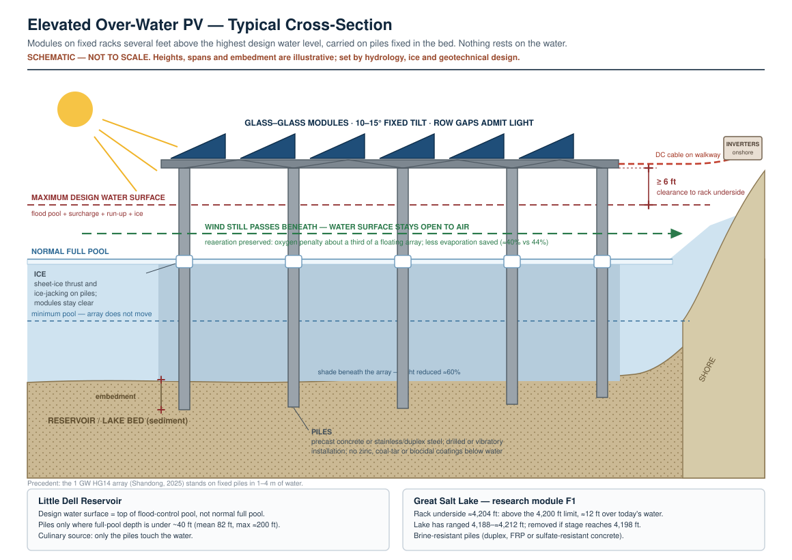

# Little Dell Reservoir — Elevated Over-Water Photovoltaic Pre-Feasibility Site Plan

> **Design basis:** modules are mounted on racks several feet above the water, carried on piles fixed in the reservoir bed. Nothing rests on the water surface. This replaces the floating-array basis used in earlier drafts.

**Site:** Little Dell Reservoir, Parleys Canyon, Salt Lake County, Utah
**Owner/operator:** Salt Lake City Department of Public Utilities (SLCDPU)
**Prepared for:** Isha Gupta, MD
**Date:** 17 August 2026
**Companion drawings:** `assets/little-dell-site-plan.svg` (plan) · `assets/elevated-over-water-pv-section.svg` (cross-section)
**Companion strategy document:** *Multifunction Solar on Utah's Public Waters and Working Lands*

---

## 1. Status, Purpose and Limitations

This is a **Class 5 pre-feasibility site plan** (AACE International classification; expected accuracy −30% / +50%). It exists to make a specific, quantified proposition discussable with SLCDPU, not to support permitting or construction.

**What this document is not:** it is not based on survey, bathymetry, geotechnical, or metocean data. Shoreline geometry, bathymetric contours, pile lengths, and the positions of the intake tower, spillway, access road, and any existing electrical service are **schematic**. Every one of them must be replaced with as-built and survey data before this advances.

**Where Little Dell sits in the overall strategy.** Little Dell is a **Phase 4** site in the companion strategy document — deliberately *not* a first mover. The reason is structural: the drinking-water framing that makes the site attractive is the same framing that makes its owner maximally risk-averse. This site plan should be used as a credibility artifact and a conversation opener with SLCDPU, and as the target that Phase 2 demonstration data is designed to unlock. Section 14 identifies the site that should be built first.

---

## 2. Site Parameters

### 2.1 Verified or well-attested

| Parameter | Value | Source confidence |
|---|---|---|
| Storage capacity | 20,500 acre-feet | Attested by multiple sources |
| Full-pool surface area | ≈249 acres | Attested; internally consistent with capacity |
| Mean depth (derived) | 82 ft (20,500 af ÷ 249 ac) | Derived — this cross-check validates the pair above |
| Maximum depth | ≈200 ft | Consistent with a 224 ft dam |
| Dam | Zoned earthfill, 224 ft high, ≈1,700 ft crest | Attested |
| Constructed | 1987–1993 | Attested |
| Project sponsors | USACE, Metropolitan Water District of Salt Lake City, Salt Lake County | Attested |
| Authorized purposes | Culinary water supply, flood control, wildlife enhancement | Attested |
| Watershed status | Parleys Canyon Protected Watershed; ≈25% of SLCDPU service-area culinary supply originates in these watersheds | Attested (SLCDPU) |
| Use restrictions | No motorized craft, no paddleboards, no dogs, no swimming; fishing permitted, artificial lures only | Attested (SLCDPU) |
| Fishery | Bonneville cutthroat trout brood stock (catch-and-release), plus brook and brown trout | Attested |
| Nearby cultural resource | Little Dell Station, NRHP-listed 1971, ≈1,000 ft NE of the reservoir's north tip | Attested |

### 2.2 Assumed — must be replaced with site data

| Parameter | Assumed value | Note |
|---|---|---|
| Full-pool water surface elevation | ≈5,790 ft | Published figures range 5,774–5,798 ft. Obtain the operating stage–area–capacity table from SLCDPU. |
| Gross annual lake evaporation | 3.0 ft/yr | **The weakest number in this plan.** A cold, deep, canyon-shaded, high-elevation reservoir plausibly evaporates 2.2–3.0 ft/yr. Regional pan data is not adequate. |
| Seasonal stage range and flood-control pool | Not established | Sets the rack height (underside ≥ 6 ft above the maximum design water surface) and the exposed pile length at minimum pool. Non-negotiable data need. |
| Bathymetry | Not established | **Decides where piles are feasible at all** (§5.2). |
| Ice-cover duration and thickness | Not established | Drives a first-order feasibility question (§6.4). |
| Existing electrical service at dam/recreation area | Not established | Determines whether interconnection is trivial or project-defining. |
| Design wind speed / fetch-limited wave height | Not established | Canyon channelling may produce a directional wind regime worse than regional averages suggest. |

---

## 3. Siting Constraints Inventory

The array zones in §4 are what remains after subtracting the following. Each exclusion is shown on the drawing.

| # | Constraint | Basis | Effect on layout |
|---|---|---|---|
| C-1 | **Dam safety exclusion** | Embankment protection, spillway approach hydraulics, intake-tower access, emergency drawdown | 500 ft standoff from the dam axis; no piles, no array, no cable crossing within the zone |
| C-2 | **Inflow delta exclusion** | Dell Creek delta sediment deposition; shallow and stage-variable; tributary access for spawning fish | Northern basin fully excluded (≈35 acres) |
| C-3 | **Littoral shelf — re-scoped** | Bonneville cutthroat and brook/brown trout littoral habitat; macrophyte zone; drawdown-exposed bench | The floating plan excluded the whole band, partly because floats would ground at drawdown. Piles remove that reason. The remaining reason is habitat: no piles or canopy over spawning areas or dense macrophyte beds identified with Utah DWR; elsewhere, wider row spacing to admit light. |
| C-8 | **Water-depth limit (pile feasibility)** | Precedent over-water pile arrays stand in ≈3–13 ft of water; cost rises steeply with depth | Arrays limited to full-pool depth ≲ 40 ft pending geotechnical work (§5.2) |
| C-4 | **Parleys Creek diversion inflow** | Localized mixing and turbidity plume; SLCDPU operational access | Local standoff on the west shore |
| C-5 | **Recreation and navigation** | Hand-launch ramp, shore fishing access, non-motorized craft circulation | Clear corridor from the ramp to open water; array kept off the west shore near the day-use area |
| C-6 | **Primary viewshed** | Little Mountain Pass / Emigration Canyon overlook; Little Dell Station NRHP setting | Coverage cap; low-profile, non-reflective, dark-toned components; no onshore structures visible from the overlook |
| C-7 | **Drinking Water Source Protection** | Utah Admin. Code R309-605; Zone 1 for reservoirs = ½ mile from the high-water mark | Requires a DWSP Plan amendment covering the entire project footprint including staging areas |

---

## 4. Array Configuration

### 4.1 Schedule of areas

| Zone | Phase | Area (ac) | Coverage of full pool | Capacity (MW_dc) | Energy (MWh/yr) | Evaporation saved (af/yr) |
|---|---|---|---|---|---|---|
| **A** | 1 — Demonstration | 12.45 | 5.0% | 4.98 | ≈8,200 | ≈14 |
| **B** | 2 — Build-out | 30.00 | 12.1% | 12.00 | ≈19,800 | ≈34 |
| **C** | 3 — Build-out | 20.00 | 8.0% | 8.00 | ≈13,200 | ≈23 |
| **Total** | | **62.45** | **25.1%** | **24.98** | **≈41,200** | **≈71** (95% UI 31–122) |

### 4.2 Basis of the numbers

- **Power density 0.40 MW_dc/acre.** Carried over from the earlier low-tilt basis. Elevated arrays spaced more widely to let light reach the water would carry less capacity per acre — a trade-off to settle with Utah DWR (C-3).
- **Specific yield 1,650 MWh/MW_dc·yr.** This is *lower* than the 1,750 figure used in the companion strategy document's generic screening, and deliberately so: over-water arrays are normally installed at 10–15° tilt for wind-load reasons rather than the ≈30° latitude-optimal tilt, which costs roughly 5–8% of annual yield. A gain of several percent from module cooling over water is netted against that penalty. At 5,790 ft with meaningful winter snow, low tilt also sheds snow poorly — see §6.5.
- **Evaporation suppression ≈40% beneath the elevated canopy (95% UI ≈18–64%).** No lake measurement exists for elevated arrays. Floating arrays measure 44% at full scale and canal-top studies assume 44–90% for fully covered canals; an open-sided canopy blocks radiation but lets wind pass beneath, so suppression is set lower than both. A small downwind-sheltering bonus is added. Values in the table are medians with 95% uncertainty intervals from the Monte Carlo projections (`docs/05-quantitative-ecological-projections.md`). Note that whole-reservoir suppression is *not* simply suppression × coverage: an array alters wind field and surface temperature beyond its own footprint, in both directions. The number above should be read as an upper bound pending measurement.
- **Module count:** ≈8,300 modules at 600 W for Zone A; ≈41,600 at full build-out.

### 4.3 Context for the energy number

Full build-out (≈41,200 MWh/yr) is roughly the annual consumption of **4,500–5,000 Utah households**, or a meaningful fraction of SLCDPU's own pumping and treatment load. Zone A alone (≈8,200 MWh/yr) is a real, non-token quantity.

### 4.4 Context for the water number — read this before using it

Full build-out saves about **71 acre-feet per year (95% UI 31–122)**, which is approximately **0.08% (0.04–0.14%) of SLCDPU's annual water delivery** (≈80,000–97,000 acre-ft/yr). This is a genuinely small number.

**Do not present Little Dell as a water conservation project.** The evaporation benefit is real, measurable, and worth quantifying — but it is not the case for the project and will not survive a competent engineer's scrutiny as such. The case for Little Dell is:

1. Distributed generation at a site with existing access, existing land control, and proximity to load;
2. A water-quality intervention — reduced solar radiation at the surface suppresses algal production and may reduce disinfection-byproduct precursor loading, which is a direct benefit to SLCDPU's treatment obligation;
3. The best-instrumented over-water PV research site in the Intermountain West.

---

## 5. Elevated Structure and Pile Foundations

### 5.1 Design concept

**Nothing rests on the water.** Modules sit on fixed racks whose underside is at least **6 ft above the maximum design water surface**, carried on piles driven or drilled into the reservoir bed. Because Little Dell is a flood-control reservoir, the design water surface is the top of the flood-control pool plus surcharge, wave run-up and ice — **not** normal full pool. Those elevations must be obtained from SLCDPU and USACE (§15).

- **10–15° fixed tilt**, rows oriented east–west, azimuth due south. Rows spaced so that a share of direct and diffuse light still reaches the water (§9 monitors the result).
- **Maintenance from walkways on the rack structure**, not from boats on the water wherever practicable; any boat access by non-motorized or electric craft only, consistent with the existing restriction.
- **No hydraulic actuation, no tracking, no fluids on the structure.**
- **What the change from floating removes:** floats in contact with drinking water, mooring lines and anchors that move with the stage, the risk of the array grounding on the shelf at drawdown, and ice sheets bearing directly on the array. The water surface beneath stays open to air and wind, which is why the projected oxygen penalty is roughly a third of the floating case (§9, `docs/05-quantitative-ecological-projections.md`).
- **What it adds:** foundations in the reservoir bed, pile installation noise and sediment disturbance, ice loads on piles, and a taller visual profile.

### 5.2 The depth constraint — the decisive finding for this site

Every large pile-mounted over-water array found stands in **shallow water**. The 1 GW HG14 offshore array in Shandong (commissioned December 2025) uses fixed piles in **1–4 m (≈3–13 ft)** of water; Chinese aquaculture and reservoir arrays are similar. Little Dell has a **mean depth of 82 ft and a maximum of about 200 ft**.

| Option | Where | Pile length (water + embedment) | Assessment |
|---|---|---|---|
| **1. Shallow-margin siting** | Upper basin and perimeter areas with full-pool depth ≲ 40 ft | ≈60–90 ft | Buildable with conventional marine piling. Overlaps the littoral shelf that the floating plan excluded — see C-3. |
| **2. Deep-basin siting** | Central basin as drawn in the floating layout (≈80–200 ft deep) | ≈120–250+ ft | Offshore-scale foundations in a drinking-water reservoir, with pile-installation vibration near an earthfill dam. **Not recommended.** |

**Recommendation: Option 1, at demonstration scale (Zone A) only, pending a bathymetric survey.** The zone positions on the site-plan drawing are schematic and must be moved to the shallowest qualifying water once bathymetry exists. The ≲ 40 ft limit is a planning assumption, not a design value; the geotechnical investigation sets the real one.

### 5.3 Piles

- **Count:** a projected **≈310 [110, 650]** piles for Zone A and **≈1,550 [540, 3,250]** at full build-out (95% uncertainty intervals), depending mainly on span. Large-span truss platforms need far fewer piles than short-span pond racks.
- **Bed footprint:** ≈160 m² [40, 540] for Zone A — under 0.1% of the zone's water surface.
- **Material (culinary source):** precast, fully cured prestressed-concrete piles, or stainless/duplex steel. **No zinc galvanizing, no coal-tar or biocidal coatings, no in-situ grouting below water.**
- **Installation:** drilled or vibratory installation preferred over impact driving, to limit underwater noise and vibration transmitted toward the dam; silt curtains around each work area; installation outside cutthroat spawning windows.
- **No piles within the dam safety exclusion zone** under any configuration.

### 5.4 What must be modelled before this is credible

1. Bathymetric survey and the resulting area with full-pool depth ≲ 40 ft outside the dam-safety and delta exclusions.
2. Design water surface: top of flood-control pool, surcharge, wave run-up and ice.
3. Ice loads on piles — sheet-ice thrust, and **ice-jacking** (ice frozen to piles lifting them as the stage rises).
4. Geotechnical capacity and embedment of reservoir-bed sediments; scour around piles.
5. Vibration transmission from pile installation toward the embankment, reviewed by dam-safety engineers.

---

## 6. Drinking-Water Materials and Contamination-Control Protocol

**This is the section that determines whether the project happens.** SLCDPU's institutional risk calculus reduces to one question: does this introduce a contamination pathway into a culinary source? The correct response is not a probability argument. It is engineered elimination of the pathway, documented item by item.

### 6.1 Prohibited on the water

| Prohibited | Rationale |
|---|---|
| Polymer-backsheet PV modules | Backsheet degradation and fluoropolymer (PFAS) release into the water column |
| Galvanized steel, zinc anodes, any sacrificial anode | Zinc and cadmium leaching |
| Copper-bearing or biocidal antifouling coatings | Direct toxicant introduction |
| Hydraulic systems, oil-filled transformers, oil-filled switchgear, engine-driven equipment | Petroleum-product release pathway |
| Batteries or energy storage on the water | Electrolyte release pathway |
| PVC in submerged service | Plasticizer leaching |
| Wet-cast concrete placement in or over water | Uncured cement leachate, high pH plume |

### 6.2 Required

| Requirement | Specification |
|---|---|
| Modules | **Glass–glass, frameless or anodized-aluminium-framed, no polymer backsheet.** Chosen for leachate control and durability — the bifacial gain over water is small (water albedo ≈5–8%) and is not the justification. |
| Piles | Precast, fully cured prestressed concrete or stainless/duplex steel; leachate-tested; no zinc, coal-tar or biocidal coatings |
| Racks | 316 stainless or anodized aluminium; all components above the design water surface |
| Fasteners and hardware | 316 stainless steel throughout; no dissimilar-metal couples |
| Cabling | Double-insulated, halogen-free, within continuous HDPE conduit; no jointed splices below water |
| Pile installation | Drilled or vibratory; silt curtains; no in-situ grouting below water |
| Power electronics | **All inverters, transformers, switchgear and metering onshore.** DC only on the structure. |
| Transformer | Dry-type, or natural-ester fluid within full secondary containment sized to 110% of fluid volume |
| Onshore compound | Bunded, impermeable-surfaced, sited outside the R309-605 immediate protection area to the extent feasible |
| Construction | Pile installation from a barge or from the shore at drawdown, with deployed spill boom; refuelling and any hydraulic maintenance strictly onshore |

### 6.3 Verification programme

- Pre-installation leachate testing of every water-contacting material under site-representative temperature and pH.
- Baseline water-quality monitoring for a **minimum of 12 months before installation** — this is what makes any subsequent claim defensible, and it is the single most common omission in over-water PV proposals.
- Post-installation monitoring on the schedule in §9, with pre-registered thresholds and an agreed removal trigger (§11).

### 6.4 Ice — the unresolved risk

At ≈5,790 ft, sheet ice will form. Elevating the array keeps ice off the modules, but the piles must carry **sheet-ice thrust** and resist **ice-jacking** — ice frozen to a pile lifting it as the stage rises, a known failure mode for piles in freezing reservoirs. Options are (a) embed piles deep enough to resist uplift and size them for thrust, (b) fit low-adhesion sleeves or ice collars at the waterline band, or (c) a bubbler system around pile groups, which adds equipment and energy demand. **This must be resolved analytically before Zone A is proposed to SLCDPU**, because it will otherwise be the first question a dam-safety engineer asks.

### 6.5 Snow

Low tilt (10–15°) sheds snow poorly. Expect material winter production losses and specify structural snow loading accordingly. Do not model this site with a flat annual capacity factor.

---

## 7. Electrical and Interconnection

**Configuration:** DC collection on the water → submarine DC cable in continuous conduit → shore transition vault → onshore inverter/transformer compound → point of interconnection.

- 1500 V DC collection minimizes conductor size and loss over the ≈300–600 m water-to-shore run.
- The onshore compound is sited near the existing access road terminus to avoid new ground disturbance and to keep all serviceable equipment outside the water body.

**Three interconnection options, in order of preference — all require verification:**

1. **Behind-the-meter service to SLCDPU load.** If SLCDPU has metered load at or near the site, offsetting it at retail rates is worth substantially more per MWh than wholesale export. Per the companion strategy document's economics, **power value dominates project viability** — this option should be exhausted first.
2. **Export to Rocky Mountain Power distribution** along the SR-65 corridor. Requires confirmation that distribution capacity exists; a ≈25 MW build-out will almost certainly require distribution upgrades or a transmission-level interconnection, which changes the cost picture materially.
3. **Remote net metering / bill credit** applied against SLCDPU's larger loads elsewhere in its system (e.g. treatment and pumping facilities), avoiding a physical dedicated line. Availability depends on current Utah tariff structure — verify with RMP and the Public Service Commission.

**Data need:** confirm what electrical service already exists at the dam (dam instrumentation and the recreation area almost certainly have some service) and its capacity.

---

## 8. Construction Access and Staging

- **Access:** existing paved switchback road from the SR-65 gate to the water. Confirm load rating; the road was built for recreation traffic, not pile, rack and module deliveries.
- **Staging and assembly:** the existing day-use area is the only realistic flat ground for pile and rack laydown. Assess whether it suffices without expanding the disturbed footprint.
- **Pile installation:** from a small barge, or — for shallow-margin piles — from the exposed bed during drawdown, which avoids in-water work and turbidity altogether. Any barge launch arrangement must be temporary and fully restorable.
- **Season:** construction window constrained by winter access closure and ice. Assume a single summer–autumn season for Zone A.
- **Sediment and runoff control** throughout, per R309-605 obligations, with the recognition that any turbidity event in a culinary source is a reportable and reputationally costly incident.

---

## 9. Monitoring and Instrumentation Plan

The monitoring programme is not an add-on. **It is the reason this project should be approved**, and its cost should be presented as such. Design it to be publishable.

### 9.1 Design

Paired treatment–control (BACI: Before–After, Control–Impact), with a **minimum 12-month pre-installation baseline**, treatment stations under the array (T1, T2) and a depth-matched control station in open water (C1). Pre-register hypotheses and the analysis plan before installation.

### 9.2 Instrumentation

| Parameter | Method | Stations |
|---|---|---|
| Evaporation | Evaporation pans beneath the canopy and in open water, plus an eddy-covariance mast; independent estimate via energy-balance closure | T1, C1 |
| Water temperature profile | Thermistor chain, 1 m resolution to 20 m, 15-minute logging | T1, T2, C1 |
| Dissolved oxygen | Optical sondes at 3 depths | T1, C1 |
| PAR attenuation | Sensors at surface, 0.5, 1, 2, 5 m | T1, C1 |
| Chlorophyll-a, phycocyanin | In-situ fluorometry plus periodic grab verification | T1, C1 |
| DBP precursors | TOC, DOC, UV254, SUVA — monthly, plus event sampling | T1, C1, raw intake |
| Trace metals | Zn, Cu, Pb, Sb, Cr, Ni — quarterly | T1, C1, raw intake |
| Microplastics / polymer fragments | Annual, standardized protocol | T1, C1 |
| Fish movement | Acoustic telemetry array, tagged Bonneville cutthroat | Reservoir-wide |
| Avian use | Point counts plus time-lapse camera; nesting and perching survey | Array and control shorelines |
| Meteorology | Wind speed/direction, RH, air temperature, GHI/POA | Array mast |
| Water level and waves | Pressure transducer, wave staff | Array |
| PV performance | Module-level output, back-of-module temperature | Array |
| Pile and rack integrity | Strain gauges on representative piles; ice-load and uplift monitoring; annual dive/ROV inspection of pile bases and scour | Array |

### 9.3 Pre-registered primary hypotheses

- **H1:** Under-array evaporation is reduced relative to the depth-matched control, with the effect size estimated rather than assumed.
- **H2:** Under-array PAR attenuation reduces phytoplankton biomass, with a measurable change in DBP precursor concentration at the raw intake.
- **H3:** No detectable increase in regulated or unregulated contaminants attributable to array materials, evaluated against pre-registered detection thresholds.
- **H4:** Array presence does not alter Bonneville cutthroat habitat occupancy or thermal refuge use beyond the pre-specified equivalence bounds.

Note that **H3 and H4 are framed as equivalence tests, not null-hypothesis tests.** Failing to reject a null is not evidence of safety, and a regulator with a good statistician will say so.

---

## 10. Preliminary Cost (Class 5, −30% / +50%)

| Item | Zone A (4.98 MW) | Full build-out (24.98 MW) |
|---|---|---|
| Elevated pile-mounted system, shallow-water piles, at ≈$2.10/W_dc | $10.5 M | $52.5 M |
| Monitoring programme (baseline + 3 yr operation) | $0.6 – 1.0 M | $1.2 – 1.8 M |
| Permitting, studies, ice/wave/geotech analysis | $0.4 – 0.8 M | $0.8 – 1.5 M |
| Decommissioning bond (see §11) | to be set | to be set |
| **Indicative total** | **$11.5 – 12.3 M** | **$54.5 – 55.8 M** |

**Caveat:** ≈$2.10/W_dc is an assumption for shallow-water piles; no US price data for pile-mounted over-water PV were found. It excludes ice-hardening, and it does **not** apply to deep-basin siting (Option 2, §5.2), which is unpriced and would cost several times more. Treat capital cost as the least certain number in this plan.

Levelized cost lands near **$105/MWh** when the companion model's $81/MWh (at $1.55/W) is scaled to $2.10/W. At wholesale power values this does not pay for itself on electrons alone — which is precisely why §7 option 1 (retail-rate load offset) is the pivotal commercial question.

---

## 11. Removal and Reversibility

Removability is the single strongest structural argument available for this project, and it should be written into the approval rather than merely asserted.

- **Complete removal capability:** modules, racks and cabling recoverable; piles extracted, or cut at the bed and the stubs shown to be inert.
- **Decommissioning bond** posted before installation, sized to full removal and site restoration at third-party rates.
- **Pre-agreed removal triggers,** written into the agreement, e.g. any confirmed exceedance of a pre-registered water-quality threshold attributable to the array; any dam-safety finding; any structural failure event; failure to meet H3/H4 equivalence bounds at the 3-year review.
- **Time-limited initial term** for Zone A (suggest 5 years) with renewal contingent on the monitoring record.

An owner who can revoke cheaply approves more readily than one who cannot. Design for that.

---

## 12. Approval Sequence

| Step | Body | Instrument | Notes |
|---|---|---|---|
| 1 | SLCDPU | Internal feasibility concurrence | The real gate. Everything else follows or fails here. |
| 2 | Metropolitan Water District of Salt Lake & Sandy | Concurrence as project partner | Confirm current property and operating interest |
| 3 | **USACE** | To be determined | **Critical unknown.** Little Dell was a federal joint venture; determine whether USACE retains a real-property, dam-safety, or authorization interest that creates a federal approval pathway (and potentially NEPA). Resolve this early — it can change the entire timeline. |
| 4 | Salt Lake County | Land use / co-sponsor concurrence | |
| 5 | Utah Division of Drinking Water | DWSP Plan amendment under R309-605 | |
| 6 | Utah Division of Water Quality | Section 401 certification if a federal permit is triggered; UPDES review | |
| 7 | Utah Division of Water Rights, Dam Safety | Review of any effect on the dam, spillway, or outlet works | |
| 8 | Utah DWR | Fisheries consultation — Bonneville cutthroat brood stock | Engage early; DWR is a potential ally if the telemetry study is well-designed |
| 9 | USACE Regulatory | CWA §404 applicability | Jurisdictional status post-*Sackett* to be confirmed; pile placement may constitute a discharge of fill |
| 10 | SHPO | Section 106 if a federal nexus exists — Little Dell Station NRHP setting | |
| 11 | Rocky Mountain Power | Interconnection application | |
| 12 | Salt Lake City Council | Public process, likely required regardless of legal necessity | Assume a contested public hearing and prepare for it |

---

## 13. Risk Register

| ID | Risk | Likelihood | Consequence | Mitigation |
|---|---|---|---|---|
| R-1 | SLCDPU declines on contamination-risk grounds | **High** | Project ends | Materials protocol (§6); build the evidence base at a non-culinary site first (§14) |
| R-2 | Ice thrust or ice-jacking damage to piles | **High** | Structural failure, debris in a culinary source | Ice analysis before proposing; embedment, low-adhesion sleeves or bubblers; §11 removal trigger |
| R-3 | Interconnection capacity inadequate at build-out scale | Medium-high | Zone B/C uneconomic | Confirm early; phase to match available capacity; pursue retail-offset structure |
| R-4 | Public/recreation opposition on viewshed grounds | **High** | Delay, political defeat | Visual simulations, coverage cap, siting away from the overlook axis, early engagement |
| R-5 | Evaporation benefit measures far below assumption | Medium | Credibility damage if oversold | Do not lead with the water claim (§4.4); measure before claiming |
| R-6 | Fisheries impact finding | Medium | Condition or denial | Telemetry study co-designed with Utah DWR; littoral exclusion |
| R-7 | USACE federal interest triggers NEPA | Medium | Multi-year delay | Resolve jurisdiction in Phase 0, before committing resources |
| R-8 | Pile or rack failure dropping debris near the intake or spillway | Low | Severe — dam safety and supply interruption | Conservative pile design, strain monitoring, dam-safety exclusion zone, removal trigger |
| R-9 | Capital cost exceeds estimate due to ice hardening | Medium-high | Project uneconomic | Price the ice solution before committing; treat current capex as unpriced in this respect |
| R-10 | Too little water ≲ 40 ft deep outside exclusions | Medium-high | Demonstration cannot be sited | Bathymetric survey first; fall back to SLCDPU non-culinary basins (§14) |
| R-11 | Pile installation noise or vibration | Medium | Fish injury; dam-safety concern | Drilled or vibratory installation; seasonal timing; vibration monitoring at the embankment |

---

## 14. Recommendation: De-Risk Inside SLCDPU's Own System First

Approaching SLCDPU with Little Dell as the opening proposition asks them to accept an unquantified risk to a culinary source with no prior local evidence. That is a low-probability ask.

**A far better first ask, with the same institutional counterparty:** propose the demonstration on **SLCDPU's own non-culinary water surfaces** — treatment plant basins, backwash and solids-handling ponds, or finished-water storage where an appropriately-rated cover system is already contemplated. These sites carry no raw-source ecological mandate, sit directly adjacent to significant treatment and pumping load (which unlocks the retail-offset economics of §7 option 1), and are under the same director's authority.

That sequence lets you return to Little Dell in three years with SLCDPU's own operating data, generated on SLCDPU's own equipment, answering SLCDPU's own contamination question. It converts the hardest conversation in this plan into the easiest one.

---

## 15. Immediate Data Requests to SLCDPU

Send these as a single, short, non-advocacy information request. It is also the natural pretext for a first meeting.

1. Stage–area–capacity table and current operating rule curve.
2. Historical daily or monthly water surface elevation record (10+ years).
3. Any existing meteorological, evaporation, or water-quality monitoring at or near the reservoir.
4. Bathymetric survey, if one exists post-construction — **the first item that decides whether pile-mounting is feasible here.**
5. Ice-cover observations or records.
6. Location, capacity, and metering arrangement of any existing electrical service at the dam or recreation area.
7. Current Drinking Water Source Protection Plan for the Little Dell / Parleys source.
8. Confirmation of USACE's current real-property and dam-safety interest.
9. Any prior study of solar, hydropower, or other energy development at SLCDPU watershed facilities.
10. Flood-control pool, surcharge and spillway-design water-surface elevations (with USACE) — these set the rack height.
11. Any geotechnical data on reservoir-bed sediments from dam construction.

---

*Class 5 pre-feasibility. Not for construction. All geometry schematic pending survey.*
